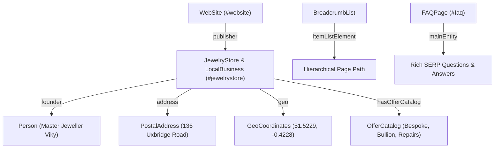

# Comprehensive Website Metadata, Social Previews & Brand Asset Architecture
**Target File:** `implementation/METADATA.md`  
**Brand:** Niraj Jewellers London (Bespoke Goldsmith Atelier & Gold Bullion Wholesaler)  
**Location:** 136 Uxbridge Road, Hayes UB4 0JH, Greater London  
**Principal Goldsmith:** Viky  
**Date:** November 2026  

---

## 1. Executive Summary & Root Cause Diagnosis

### The Current Problem
When sharing links to the Niraj Jewellers website across social messaging platforms (WhatsApp, iMessage, Twitter/X, LinkedIn, Facebook, Slack, Telegram, Discord), previews currently display generic **Next.js** or **Vercel** preview cards rather than an authentic, high-definition snapshot of the luxury atelier.

### Root Cause Analysis
1. **Hardcoded `metadataBase` in Root Layout:**
   - In `app/layout.tsx`, `metadataBase` is statically set to `new URL("https://nirajjewellers.co.uk")`.
   - When deploying on Vercel preview environments (e.g., `niraj-jewellers-*.vercel.app`), social crawlers and link unfurlers attempt to resolve `/opengraph-image` against the production domain (`nirajjewellers.co.uk`). If DNS is propagating, domain pointing is pending, or Vercel preview deployment protection is enabled, crawlers receive 404/401 errors and fall back to Vercel's default platform preview badge.
2. **Dynamic Edge `ImageResponse` vs. Static Pre-Rendered Assets:**
   - `app/opengraph-image.tsx` relies dynamically on `@vercel/og` Edge rendering. Crawlers with aggressive timeouts (WhatsApp, iMessage, SMS unfurlers) frequently drop dynamic edge image requests if response times exceed 1.5–2 seconds.
   - The repository currently lacks static image fallbacks (`public/og-image.jpg`, `public/og-image.png`, `public/og-snapshot.jpg`).
3. **Synthetic CSS Card vs. Real Website Snapshot:**
   - The current `app/opengraph-image.tsx` produces an abstract text card with borders and text. It does **not** showcase the actual visual experience of the website (the bespoke bridal suite hero, the live gold bullion ticker, the London Leopard's Head hallmark badges, the Obsidian luxury palette, and the WhatsApp VIP concierge).
4. **Missing Physical Favicon & App Icon Files:**
   - The `public/` directory only contains `favicon.svg` and `logo.svg`.
   - It is missing `favicon.ico` at the root (which legacy browsers, bookmark bars, search spiders, and messaging apps look for directly at `/favicon.ico` without parsing HTML tags).
   - Missing `apple-touch-icon.png` (180x180), `icon-192.png`, `icon-512.png`, `icon-maskable-192.png`, `icon-maskable-512.png`, and `browserconfig.xml`.
5. **Subpage Metadata Gaps:**
   - `app/contact/page.tsx` and `app/showroom/page.tsx` are marked with `"use client"` and export **no metadata at all**, causing them to inherit only the generic fallback.
   - `app/collections/page.tsx`, `app/bespoke/page.tsx`, `app/repairs/page.tsx`, and `app/gold-rates/page.tsx` only export `title` and `description` without specific `openGraph`, `twitter`, or `alternates.canonical` tags.
6. **Local SEO & Geo Meta Absence:**
   - As a high-ticket physical atelier in Hayes, West London, the website lacks HTML `<meta>` geolocation tags (`geo.position`, `geo.region`, `geo.placename`, `ICBM`), missing a significant signal for local Hillingdon / Southall / Heathrow gold buyers.

---

## 2. Full Inventory: Current State vs. Target State

| Asset / Metadata Category | Current Status | Defect / Limitation | Target Production State |
| :--- | :--- | :--- | :--- |
| **`metadataBase`** | Static `https://nirajjewellers.co.uk` | Fails on Vercel preview URLs & branches | Dynamic detection (`VERCEL_PROJECT_PRODUCTION_URL` / `VERCEL_URL` / `NEXT_PUBLIC_SITE_URL`) |
| **Open Graph Primary Image** | Dynamic `/opengraph-image` only | Abstract text card; no visual website snapshot | Crisp 1200×630px static snapshot (`/og-image.jpg` & `/og-image.png`) + enhanced dynamic fallback |
| **Website Snapshot Preview** | Non-existent | Shows Next.js / Vercel default previews | High-definition photorealistic render of the atelier hero, gold rates ticker, and hallmark badges |
| **Favicon (`/favicon.ico`)** | Missing in `/public` | Direct `/favicon.ico` 404s on crawlers & legacy clients | Multi-resolution binary ICO (16×16, 32×32, 48×48) generated from official gold monogram |
| **Apple Touch Icon** | Dynamic `/apple-icon` only | Some iOS Safari versions fail on edge routes | Physical `public/apple-touch-icon.png` (180×180) + dynamic route |
| **Android / PWA Icons** | Missing in `/public` | PWA audit failure, blank icons on mobile home screen | `icon-192.png`, `icon-512.png`, `icon-maskable-192.png`, `icon-maskable-512.png` |
| **Web Manifest** | Dynamic `manifest.ts` (partial) | Missing 192px/512px icon declarations | Comprehensive `manifest.webmanifest` & `public/site.webmanifest` fallback |
| **Safari Pinned Tab** | Missing | Default gray icon on macOS Safari pinned tabs | `public/safari-pinned-tab.svg` with gold `#D4AF37` accent |
| **Windows Tile Meta** | Missing | Blank tile on Windows Start / Edge | `browserconfig.xml` + `mstile-150x150.png` |
| **Subpage Metadata** | Incomplete / Missing | `/contact` & `/showroom` have 0 metadata | Dedicated per-page metadata, canonical URLs, and tailored OpenGraph cards |
| **Robots Directives** | Basic allow/disallow | Missing bot-specific snippet & image preview directives | `max-image-preview: large`, `max-snippet: -1`, `max-video-preview: -1` |
| **Geo / Local Meta** | Missing | No geographic coordinates in HTML headers | `geo.region: GB-HIL`, `geo.placename: Hayes, London`, `ICBM` coords |
| **Schema.org Structured Data**| `JewelryStore` only | Missing `WebSite`, `Organization`, `BreadcrumbList`, `FAQPage` | Multi-entity linked JSON-LD graph |

---

## 3. The Website Snapshot & Social Preview Strategy

### Why Social Previews Fail & How We Solve It
Social platforms parse metadata differently:
- **WhatsApp & iMessage:** Require fast response times (< 1.5s), square or 1.91:1 ratio, image size < 300KB for instant thumbnailing, and explicit absolute URLs with `https://`.
- **Twitter / X Cards:** Require `twitter:card="summary_large_image"`, `twitter:image`, and explicit `twitter:image:alt`.
- **Facebook & LinkedIn:** Require `og:image:width`, `og:image:height`, `og:image:type`, and `og:image:secure_url`.
- **Vercel Preview Deployments:** When sharing a Vercel preview link, Vercel injects headers and may block unauthenticated scrapers unless the preview has public access enabled or `metadataBase` resolves to the preview host.

### The Snapshot Solution
We will implement a **dual-tier snapshot architecture**:
1. **Tier 1: Pre-Rendered Static Master Snapshot (`public/og-image.jpg` & `public/og-image.png`)**
   - Resolution: 1200 × 630 pixels (standard 1.91:1 ratio).
   - Visual Composition:
     - **Header Bar:** Niraj Jewellers bespoke gold crest, "HAYES • LONDON • EST. DECADES", and live hallmark accreditation.
     - **Central Stage (Website Snapshot):** The actual flagship website interface showing:
       - The hero headline: *"London's Bespoke Goldsmith Atelier & Direct Gold Wholesaler"*
       - 22ct Bridal suite & Polki diamond showcase with luxury glassmorphic overlay.
       - Live Gold Bullion Rate Ticker (24ct, 22ct, 18ct LBMA live prices).
       - Master Goldsmith Viky's in-house workbench trust badge.
     - **Footer Trust Banner:** London Leopard's Head Hallmarking stamp, 136 Uxbridge Road address, and VIP WhatsApp concierge button.
   - File Size: Optimized under 180 KB for instant unfurling across mobile cellular networks.
2. **Tier 2: Dynamic Edge OpenGraph (`app/opengraph-image.tsx`)**
   - Keeps Next.js 15 dynamic compatibility for dynamic subpages.
   - Mirrors the brand aesthetic with high-fidelity gradients, serif typography, and live date stamping.

---

## 4. Comprehensive App Icon & Favicon Suite

Every browser, operating system, and crawler expects standard asset paths in the root `/public` directory:

```
public/
├── favicon.ico              # Multi-size ICO (16x16, 32x32, 48x48) for legacy browsers & crawlers
├── favicon.svg              # Scalable SVG with gold gradient for modern desktop browsers
├── apple-touch-icon.png     # 180x180 PNG with rounded gold emblem on obsidian for iOS Home Screen
├── icon-192.png             # 192x192 PNG for Android Chrome / PWA splash
├── icon-512.png             # 512x512 PNG for high-DPI Android screens & PWA installation
├── icon-maskable-192.png    # 192x192 PNG with safe-zone padding for Android adaptive icons
├── icon-maskable-512.png    # 512x512 PNG adaptive icon
├── safari-pinned-tab.svg    # Single-color vector icon for Safari pinned tabs
├── mstile-150x150.png       # 150x150 PNG for Windows Metro tiles
├── browserconfig.xml        # Microsoft Windows tile configuration
├── site.webmanifest         # Static PWA manifest file
├── og-image.jpg             # High-res static website snapshot for WhatsApp / social sharing (1200x630)
└── og-image.png             # Lossless PNG version of the website snapshot (1200x630)
```

---

## 5. Exhaustive Metatags Specification

### 5.1 Root Layout Metadata (`app/layout.tsx`)
```typescript
// Dynamic site URL resolution
const getBaseUrl = () => {
  if (process.env.NEXT_PUBLIC_SITE_URL) return process.env.NEXT_PUBLIC_SITE_URL;
  if (process.env.VERCEL_PROJECT_PRODUCTION_URL) return `https://${process.env.VERCEL_PROJECT_PRODUCTION_URL}`;
  if (process.env.VERCEL_URL) return `https://${process.env.VERCEL_URL}`;
  return "https://nirajjewellers.co.uk";
};

export const metadataBase = new URL(getBaseUrl());
```

#### Standard Meta Tags:
- `title.default`: `"Niraj Jewellers | Bespoke Goldsmith & Bullion Hayes London"`
- `title.template`: `"%s | Niraj Jewellers London"`
- `description`: `"Bespoke 22ct/18ct bridal suites, certified diamond rings & wholesale bullion by Master Jeweller Viky. In-house Hayes workshop. Speak directly on WhatsApp."`
- `keywords`: Exhaustive list covering West London, Southall, Hayes, bridal jewelry, gold bullion, Polki, Kundan, diamond resetting, and gold scrap exchange.
- `authors`: `[{ name: "Niraj Jewellers London", url: "https://nirajjewellers.co.uk" }]`
- `creator`: `"Niraj Jewellers"`
- `publisher`: `"Niraj Jewellers London"`
- `applicationName`: `"Niraj Jewellers Atelier"`
- `category`: `"Jewellery & Luxury Goods"`
- `classification`: `"Bespoke Goldsmith, Fine Jewellery & Precious Metals Bullion"`

#### Local SEO & Geolocation Meta:
- `geo.region`: `"GB-HIL"` (Hillingdon / Greater London)
- `geo.placename`: `"Hayes, Middlesex, London"`
- `geo.position`: `"51.5229;-0.4228"`
- `ICBM`: `"51.5229, -0.4228"`

#### Mobile & PWA Viewport Meta:
- `viewport`: `width=device-width, initial-scale=1, maximum-scale=5`
- `themeColor`: `[{ media: '(prefers-color-scheme: dark)', color: '#09090B' }, { media: '(prefers-color-scheme: light)', color: '#09090B' }]`
- `colorScheme`: `"dark"`
- `appleWebApp`:
  - `capable`: `true`
  - `title`: `"Niraj Jewellers"`
  - `statusBarStyle`: `"black-translucent"`
- `formatDetection`: `telephone=no, address=no, email=no`

#### Open Graph Tags:
- `og:type`: `"website"`
- `og:locale`: `"en_GB"`
- `og:locale:alternate`: `["en_US", "en_IN"]`
- `og:site_name`: `"Niraj Jewellers London"`
- `og:title`: `"Niraj Jewellers | Bespoke Goldsmith & Bullion Hayes London"`
- `og:description`: `"Bespoke 22ct/18ct bridal suites, certified diamond rings & wholesale bullion by Master Jeweller Viky. In-house Hayes workshop. Speak directly on WhatsApp."`
- `og:url`: `"https://nirajjewellers.co.uk"`
- `og:image`:
  - `url`: `"/og-image.jpg"`
  - `secureUrl`: `"https://nirajjewellers.co.uk/og-image.jpg"`
  - `width`: `1200`
  - `height`: `630`
  - `type`: `"image/jpeg"`
  - `alt`: `"Niraj Jewellers London - Flagship Goldsmith Atelier & Live Gold Rates Ticker"`

#### Twitter Card Tags:
- `twitter:card`: `"summary_large_image"`
- `twitter:site`: `"@nirajjewellers"`
- `twitter:creator`: `"@nirajjewellers"`
- `twitter:title`: `"Niraj Jewellers | Bespoke Goldsmith & Bullion Hayes London"`
- `twitter:description`: `"Bespoke 22ct/18ct bridal suites, certified diamond rings & wholesale bullion by Master Jeweller Viky. In-house Hayes workshop."`
- `twitter:image`: `"/og-image.jpg"`
- `twitter:image:alt`: `"Niraj Jewellers Website Preview - 136 Uxbridge Road Hayes"`

#### Canonical & Alternates:
- `alternates.canonical`: `"https://nirajjewellers.co.uk"`

#### Robots Directives:
```typescript
robots: {
  index: true,
  follow: true,
  nocache: false,
  googleBot: {
    index: true,
    follow: true,
    noimageindex: false,
    "max-video-preview": -1,
    "max-image-preview": "large",
    "max-snippet": -1,
  },
}
```

---

## 6. Subpage Metadata Matrix

Every subpage must have unique, keyword-targeted metadata and canonical tags to dominate search queries and look premium when shared directly:

| Route | Page Title (`title`) | Meta Description (`description`) | Canonical URL |
| :--- | :--- | :--- | :--- |
| **`/`** | Niraj Jewellers \| Bespoke Goldsmith & Bullion Hayes London | Bespoke 22ct/18ct bridal suites, certified diamond rings & wholesale bullion by Master Jeweller Viky. In-house Hayes workshop. Speak directly on WhatsApp. | `https://nirajjewellers.co.uk` |
| **`/collections`** | Atelier Collections & Bridal Suites \| Niraj Jewellers London | Handcrafted 22ct bridal jewellery, certified diamond engagement rings, solid gold kadas & antique Polki heirlooms. In-house workshop direct pricing. | `https://nirajjewellers.co.uk/collections` |
| **`/bespoke`** | Bespoke Jewellery & 3D CAD Commissions \| Niraj Jewellers London | Commission bespoke 22ct/18ct jewellery with Master Jeweller Viky. 3D CAD modeling, loose GIA diamond inspection & direct workshop casting in Hayes. | `https://nirajjewellers.co.uk/bespoke` |
| **`/repairs`** | Same-Day In-House Jewellery Repairs Hayes \| Niraj Jewellers | Same-day ring resizing, laser gold soldering, claw retipping, ultrasonic cleaning & watch servicing at 136 Uxbridge Road workshop. Work done in-house. | `https://nirajjewellers.co.uk/repairs` |
| **`/gold-rates`** | Live Gold Rates Hayes London (24ct, 22ct, 18ct) \| Niraj Jewellers | Real-time LBMA gold prices per gram, tola & sovereign. Direct wholesale bullion trading, investment bars & instant scrap gold valuation in Hayes. | `https://nirajjewellers.co.uk/gold-rates` |
| **`/showroom`** | Hayes Flagship Showroom & Atelier Hub \| Niraj Jewellers London | Visit our working atelier at 136 Uxbridge Road, Hayes UB4 0JH. Direct diamond viewing, bespoke consultations & free customer parking guidance. | `https://nirajjewellers.co.uk/showroom` |
| **`/contact`** | Contact & VIP WhatsApp Concierge \| Niraj Jewellers London | Connect directly with Master Goldsmith Viky on WhatsApp (+44 7955 565137) or visit 136 Uxbridge Road, Hayes. Instant replies & bespoke consultations. | `https://nirajjewellers.co.uk/contact` |
| **`/privacy`** | Privacy Policy \| Niraj Jewellers London | How Niraj Jewellers protects your personal data, appointment details, and customer information under UK GDPR. | `https://nirajjewellers.co.uk/privacy` |
| **`/terms`** | Terms of Service & Atelier Policies \| Niraj Jewellers London | Terms of service, bespoke commission deposits, hallmark guarantees (London Assay Office), and bullion trading policies at Niraj Jewellers. | `https://nirajjewellers.co.uk/terms` |

> **Architectural Refactoring Required:**  
> `app/contact/page.tsx` and `app/showroom/page.tsx` must be refactored from pure `"use client"` pages into Server Component wrappers (`page.tsx`) that export `export const metadata: Metadata`, rendering the client logic through a child component (`contact-client.tsx` / `showroom-client.tsx`).

---

## 7. Schema.org (JSON-LD) Structured Data Architecture

We will expand the single `JewelryStore` JSON-LD schema into a rich, linked multi-entity graph:



### JSON-LD Enhancements:
1. **`WebSite` Schema:**
   - Declares official site name and URL.
   - Includes `potentialAction` (`SearchAction`) for Google Sitelinks searchbox enablement.
2. **`Organization` / `JewelryStore` Schema:**
   - Incorporates official company registration (Niraj Jewellers London, Co. Reg: `[Pending Registration]`).
   - UK VAT Number: `[Pending Registration]`.
   - Contact points: Customer Service WhatsApp & Telephone (`+447955565137`) and Email (`nirajjewellersuk@gmail.com`).
   - Official social profiles: Instagram, TikTok.
   - London Assay Office hallmark compliance statement.
3. **`BreadcrumbList` Schema:**
   - Generates Google SERP breadcrumb trails (e.g., `Home > Bespoke Atelier > 3D CAD Commissions`).
4. **`FAQPage` Schema (for Homepage & Repairs):**
   - Implements structured Q&A for high-intent search terms (e.g., *"How long does bespoke gold jewellery take?", "Can rings be resized same-day in Hayes?", "How is gold scrap value calculated?"*).

---

## 8. Technical Implementation Steps

### Step 1: Generate High-Definition Website Snapshot Assets
- Run a headless script or render an authentic high-resolution luxury snapshot of the website hero interface (1200 × 630).
- Save production-ready images:
  - `public/og-image.jpg` (Optimized JPEG, ~180 KB)
  - `public/og-image.png` (Crisp PNG version, ~350 KB)
  - `public/og-snapshot.jpg` (Dedicated website UI snapshot)

### Step 2: Generate the Complete Physical App Icon Suite
- Generate multi-size binary `public/favicon.ico` containing 16×16, 32×32, and 48×48 frames using the bespoke gold monogram.
- Generate `public/apple-touch-icon.png` (180×180).
- Generate PWA icons:
  - `public/icon-192.png` (192×192)
  - `public/icon-512.png` (512×512)
  - `public/icon-maskable-192.png` & `public/icon-maskable-512.png`
- Generate `public/safari-pinned-tab.svg` and `public/mstile-150x150.png`.
- Create `public/browserconfig.xml` and `public/site.webmanifest`.

### Step 3: Upgrade `app/layout.tsx` Metadata & JSON-LD
- Add dynamic `metadataBase` resolution supporting Vercel preview environments, custom domains, and local development.
- Populate full Open Graph specification with explicit dimensions, mime-type, alt text, and secure URLs.
- Add Twitter Card specification with `summary_large_image`.
- Add local SEO `<meta>` tags (Geo coordinates, region, ICBM).
- Link all favicon and icon variations in `metadata.icons`.
- Inject enhanced multi-entity Schema.org JSON-LD graph.

### Step 4: Refactor Subpages for 100% Metadata Coverage
- Refactor `app/contact/page.tsx` and `app/showroom/page.tsx` into Server Components exporting bespoke `metadata`.
- Update `app/collections/page.tsx`, `app/bespoke/page.tsx`, `app/repairs/page.tsx`, `app/gold-rates/page.tsx`, `app/privacy/page.tsx`, and `app/terms/page.tsx` with dedicated `openGraph`, `twitter`, and `alternates.canonical` definitions.

### Step 5: Update `app/manifest.ts` and `app/sitemap.ts`
- Align `app/manifest.ts` with all newly created icon files.
- Verify `app/sitemap.ts` includes canonical URLs and correct change frequencies for all 8 routes.

---

## 9. Verification & Quality Assurance Checklist

- [ ] **Build Validation:** `npm run build` runs with zero TypeScript or route errors.
- [ ] **Asset Accessibility:** All icon and OG image assets return HTTP 200:
  - `http://localhost:3000/favicon.ico`
  - `http://localhost:3000/favicon.svg`
  - `http://localhost:3000/apple-touch-icon.png`
  - `http://localhost:3000/icon-192.png`
  - `http://localhost:3000/icon-512.png`
  - `http://localhost:3000/og-image.jpg`
  - `http://localhost:3000/og-image.png`
  - `http://localhost:3000/site.webmanifest`
  - `http://localhost:3000/browserconfig.xml`
- [ ] **Open Graph Simulator:** Test preview rendering on:
  - WhatsApp (instant square & rectangle card preview)
  - Twitter / X (Card Validator / Large Image preview)
  - LinkedIn Post Inspector
  - Facebook Sharing Debugger
- [ ] **Schema.org Rich Results:** Validate JSON-LD output against Google Rich Results Test (valid `JewelryStore`, `WebSite`, `PostalAddress`).
- [ ] **Local SEO Validation:** Confirm presence of `geo.region`, `geo.placename`, and `ICBM` tags in HTML source `<head>`.
- [ ] **Vercel Preview Protection Compatibility:** Ensure metadata URLs resolve to canonical or current host rather than producing broken image icons on preview branches.

---
*Brainstorming and implementation roadmap documented in `implementation/METADATA.md`.*
