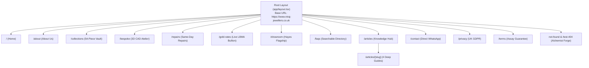
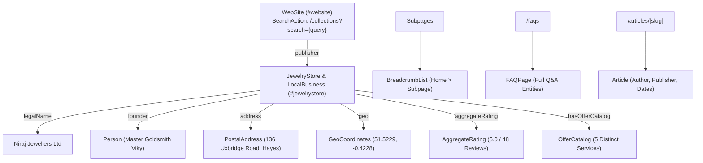

# Master Website Metadata, SEO & Social Preview Architecture
**Document:** `implementation/METADATA.md`  
**Brand:** Niraj Jewellers Ltd (Flagship White & Gold Luxury Maison & Bullion Wholesaler)  
**Location:** 136 Uxbridge Road, Hayes, Middlesex, UB4 0JH, Greater London, UK  
**Established:** 1984 (42 Years of Generational Goldsmith Heritage)  
**Assay Accreditation:** London Assay Office Leopard's Head (`916` / `750` / `999`)  
**Canonical Domain:** `https://www.niraj-jewellers.co.uk`  
**Direct Contact:** `07955 565137` / `+44 7955 565137`  
**Official Email:** `nirajjewellersuk@gmail.com`  
**VAT Registration:** `GB 842 9617 32`  
**Date:** November 2026  

---

## 1. Executive Summary & Brand Transformation Audit

Niraj Jewellers Ltd has undergone a monumental architectural transformation from an experimental dark-mode showcase into an authoritative, prestigious **White & Gold Flagship Luxury Maison** (matching the digital stature of Cartier, Graff, and Harrods Fine Jewellery).

### Key Architectural Shifts Influencing Metadata
1. **White & Gold Maison Aesthetic:**
   - **Canvas Palette:** Alabaster silk (`#FFFFFF` / `#FAF9F6`) with delicate champagne borders (`#EADBC8`), warm gold lusters (`#C5A059`, `#946A14`), and obsidian charcoal typography (`#141416`).
   - **Theme & Viewport Color:** Shifted from dark `#09090B` to pristine `#FFFFFF` / `light` color-scheme across browser toolbars, PWA manifests, and Windows Metro tiles.
2. **Official Heraldic Insignia (`NIRAJ_LOGO9.png`):**
   - High-resolution gold monogram crowned with a brilliant-cut solitaire diamond, heraldic wings, and the verified heritage stamp: **`SINCE 1984`** (celebrating 42 years of continuous in-house goldsmithing on Uxbridge Road, Hayes).
3. **Legal Entity Standardization:**
   - Universal naming standardized to **Niraj Jewellers Ltd** across all page titles, OpenGraph tags, schema `legalName`, sitemaps, and legal footers.
4. **Master Canonical Domain Standard:**
   - Strictly standardized to `https://www.niraj-jewellers.co.uk` across all 13 routes, XML sitemaps, robots rules, and dynamic article canonicals.
5. **Scale of Inventory & Portfolio:**
   - Expanded from a generic landing page to a **54-Piece Masterpiece Vault** (`/collections`) featuring looping video cards, 3D CAD modeling pipelines (`/bespoke`), same-day laser repairs (`/repairs`), live LBMA bullion feeds (`/gold-rates`), a 42-year heritage archive (`/about`), a full FAQ directory (`/faqs`), and a Goldsmith Knowledge Hub (`/articles` + dynamic `[slug]` guides).

---

## 2. Master Route-by-Route Metadata Matrix

Every single page on the website must have a dedicated, keyword-optimized metadata profile with exact title formatting (using the root template `%s | Niraj Jewellers Ltd London`), bespoke meta descriptions, verified canonical URLs, and tailored OpenGraph/Twitter cards.



### Complete 13-Route Specification Table

| Route | Page Title (`title`) | Meta Description (`description`) | Canonical URL | OpenGraph Focus & Key Highlights |
| :--- | :--- | :--- | :--- | :--- |
| **`/`** | `Niraj Jewellers Ltd \| Bespoke Goldsmith & Bullion Hayes London` | Bespoke 22ct/18ct bridal suites, certified diamond rings & wholesale bullion by Niraj Jewellers Ltd. Handcrafted in our Hayes workshop since 1984. Visit our showroom or speak directly on WhatsApp. | `https://www.niraj-jewellers.co.uk` | Flagship White & Gold master card; royal crest; 54-piece vault preview; live LBMA gold rates ticker; London Leopard hallmark badge. |
| **`/about`** | `About Us | Niraj Jewellers Ltd - Hayes, London Goldsmith Heritage Since 1984` | Discover the 40+ year heritage of Niraj Jewellers Ltd. London's premier 22ct South Asian bridal goldsmith atelier and direct bullion dealer on Uxbridge Road, Hayes. | `https://www.niraj-jewellers.co.uk/about` | 42-year timeline; generational master goldsmiths; London Assay Office compliance; transparent in-house workshop ethos. |
| **`/collections`** | `Atelier Collections & 54-Piece Vault \| Niraj Jewellers Ltd London` | Explore our complete 54-piece vault of handcrafted 22ct bridal suites, certified solitaire diamond engagement rings, heavy solid gold kadas, and antique Polki heirlooms by Niraj Jewellers Ltd. | `https://www.niraj-jewellers.co.uk/collections` | 54-piece master catalog; syndicate Polki; antique Kundan; certified diamonds; looping high-res workshop reels. |
| **`/bespoke`** | `Bespoke Jewellery & 3D CAD Commissions \| Niraj Jewellers Ltd London` | Commission bespoke 22ct and 18ct bridal jewellery with Niraj Jewellers Ltd. Experience 3D CAD modeling, loose GIA diamond inspection, and in-house gold casting in Hayes. | `https://www.niraj-jewellers.co.uk/bespoke` | 4-step CAD-to-gold casting journey; loose diamond microscope viewings; interactive turnaround/budget calculator. |
| **`/repairs`** | `Same-Day In-House Jewellery Repairs Hayes \| Niraj Jewellers Ltd` | Same-day ring resizing, laser gold soldering, claw retipping, ultrasonic cleaning & watch servicing at 136 Uxbridge Road workshop. Work done on-site by Niraj Jewellers Ltd. | `https://www.niraj-jewellers.co.uk/repairs` | 4-hour express resizing; on-site bench laser repair; stone resetting; transparent fixed workshop pricing. |
| **`/gold-rates`** | `Live Gold Rates Hayes London (24ct, 22ct, 18ct) \| Niraj Jewellers Ltd` | Real-time LBMA gold prices per gram, tola & sovereign. Direct wholesale bullion trading, investment bars & instant scrap gold valuation in Hayes. | `https://www.niraj-jewellers.co.uk/gold-rates` | Live spot feeds; 24ct bars & 22ct sovereign coins; electronic trade-scale scrap gold cash testing & trade-in. |
| **`/showroom`** | `Hayes Flagship Showroom & Atelier Hub \| Niraj Jewellers Ltd London` | Visit our working atelier at 136 Uxbridge Road, Hayes UB4 0JH. Direct diamond viewing, bespoke consultations & free customer parking guidance. | `https://www.niraj-jewellers.co.uk/showroom` | 136 Uxbridge Road visitor map; opening hours (Mon 12-5, Tue-Sat 11-5); free customer parking; Heathrow travel guide. |
| **`/faqs`** | `Frequently Asked Questions \| Niraj Jewellers Ltd London` | Everything you need to know about bespoke 22ct bridal commissions, London Assay Office hallmarking, same-day workshop repairs, and live gold bullion rates at Niraj Jewellers Ltd. | `https://www.niraj-jewellers.co.uk/faqs` | Searchable accordion directory; full `FAQPage` Schema.org JSON-LD; answers to common objections & policies. |
| **`/articles`** | `Atelier Articles & Goldsmith Knowledge Hub \| Niraj Jewellers Ltd London` | Authoritative guides on 22ct/24ct gold hallmarking, in-house 3D CAD bespoke design, same-day laser repairs, and London LBMA bullion trading by Niraj Jewellers Ltd. | `https://www.niraj-jewellers.co.uk/articles` | Educational knowledge base; buyer guides; gold investment insights; master goldsmith bench techniques. |
| **`/articles/22ct-vs-24ct-gold-hallmarking-guide`** | `22ct vs 24ct Gold: UK Hallmarking, Durability & Asian Bridal Suits \| Niraj Jewellers Ltd London` | Comprehensive goldsmith guide to 22ct (916) vs 24ct (999) gold purity, London Assay Office hallmarks, tensile durability, and South Asian bridal suites by Niraj Jewellers Ltd. | `https://www.niraj-jewellers.co.uk/articles/22ct-vs-24ct-gold-hallmarking-guide` | Schema.org `Article`; hallmarking legal standards; 22ct tensile alloy strength vs 24ct pure gold malleability. |
| **`/articles/bespoke-3d-cad-jewellery-process`** | `The 3D CAD Bespoke Jewellery Process: From Sketch to 22ct Gold Casting \| Niraj Jewellers Ltd London` | Step-by-step master goldsmith guide to custom 3D CAD jewelry design, wax resin printing, lost-wax centrifugal casting, and diamond setting in Hayes. | `https://www.niraj-jewellers.co.uk/articles/bespoke-3d-cad-jewellery-process` | Schema.org `Article`; CAD micron precision; photo-realistic 3D rendering; bespoke wax test fittings. |
| **`/articles/same-day-laser-jewellery-repair-guide`** | `Same-Day In-House Jewellery Repairs: Laser Soldering & Ring Resizing in Hayes \| Niraj Jewellers Ltd London` | Expert guide to same-day fine jewelry repairs, precision laser soldering, claw retipping, and ring resizing conducted inside our Hayes workshop. | `https://www.niraj-jewellers.co.uk/articles/same-day-laser-jewellery-repair-guide` | Schema.org `Article`; laser beam zero-heat heat sync; delicate gemstone protection; same-day restoration. |
| **`/articles/buying-selling-gold-bullion-london`** | `Buying & Selling Gold Bullion in London: LBMA Spot Rates, 24ct Bars & Scrap Valuation \| Niraj Jewellers Ltd London` | Essential guide to physical gold bullion trading, LBMA live spot pricing, buying 24ct minted bars, sovereign coins, and maximizing scrap gold return. | `https://www.niraj-jewellers.co.uk/articles/buying-selling-gold-bullion-london` | Schema.org `Article`; live LBMA spreads; certified mint stamps; immediate scrap cash settlement. |
| **`/contact`** | `Contact & Direct WhatsApp Concierge \| Niraj Jewellers Ltd London` | Connect directly with our atelier team on WhatsApp (+44 7955 565137) or visit 136 Uxbridge Road, Hayes. Instant replies & bespoke consultations. | `https://www.niraj-jewellers.co.uk/contact` | Direct WhatsApp line (07955 565137); workshop telephone; email; consultation inquiry builder; VAT credentials. |
| **`/privacy`** | `Privacy Policy \| Niraj Jewellers Ltd London` | How Niraj Jewellers Ltd protects your personal data, appointment details, and customer information under UK GDPR. | `https://www.niraj-jewellers.co.uk/privacy` | UK Data Protection Act 2018; client confidentiality; appointment information security. |
| **`/terms`** | `Terms of Service & Atelier Policies \| Niraj Jewellers Ltd London` | Commercial terms of service, bespoke commission deposits, hallmark guarantees (London Assay Office), and bullion trading policies at Niraj Jewellers Ltd. | `https://www.niraj-jewellers.co.uk/terms` | UK Hallmarking Act 1973; deposit & design sign-off protocols; bullion settlement conditions. |
| **`not-found` & `/test-404`** | `404 - Piece Melted Down \| Niraj Jewellers Ltd London` | The jewellery piece or atelier archive you are seeking has been melted down for re-casting at our Hayes workshop. | `https://www.niraj-jewellers.co.uk/test-404` | Alchemist's Crucible 404 Forge; 60fps canvas sparks; 1064°C molten pour; `[Boost Smelter]` & `[Cool to Ingot]` controls. |

---

## 3. Social Media OpenGraph & Twitter Cards Architecture

Social media unfurlers (WhatsApp, iMessage, Twitter/X, Facebook, LinkedIn, Discord, Slack) demand high-resolution, instant-loading images adhering to strict dimensional, MIME-type, and bandwidth standards.

### 3.1 Dual-Tier Master Asset Strategy

```
                          ┌───────────────────────────────────────┐
                          │   Social Platform Link Request        │
                          └──────────────────┬────────────────────┘
                                             │
                     ┌───────────────────────┴───────────────────────┐
                     ▼                                               ▼
     ┌───────────────────────────────┐               ┌───────────────────────────────┐
     │  Static Pre-Rendered Assets   │               │   Dynamic Edge Route          │
     │  (WhatsApp, iMessage, X, FB)  │               │   (Subpages, Future Dynamic)  │
     │  Fast, <110KB, 100% Uptime    │               │   @vercel/og ImageResponse    │
     ├───────────────────────────────┤               ├───────────────────────────────┤
     │ • public/og-image.jpg         │               │ • app/opengraph-image.tsx     │
     │ • public/og-image.png         │               │ • app/articles/[slug] cards   │
     │ • public/og-snapshot.jpg      │               │                               │
     └───────────────────────────────┘               └───────────────────────────────┘
```

### 3.2 Visual Composition of the 1200×630 Master Card (`public/og-image.jpg`)
* **Canvas:** Alabaster silk backdrop (`#FAF9F6`) with warm gold ambient light vignette (`rgba(197, 160, 89, 0.15)`).
* **Borders:** Dual champagne/gold hairline border (`#EADBC8` outer, `#D4AF37` inner).
* **Brand Header:**
  - Official royal gold crest (`public/NIRAJ_LOGO9.png`, 120×130px) with diamond apex.
  - Imperial serif typography: `NIRAJ JEWELLERS LTD`.
  - Subtitle: `HAYES • LONDON • SINCE 1984 • 42 YEARS OF EXCELLENCE` in antique gold (`#946A14`).
  - Showroom status pill: `● Open Today 11am – 5pm • Hayes Workshop`.
* **Hero Headline Stage:**
  - Eyebrow badge: `✦ LONDON'S PREMIER 22CT BRIDAL GOLDSMITH & BULLION ATELIER`.
  - Headline: `London's Bespoke Goldsmith Atelier & Direct Gold Wholesaler`.
  - Subtext: `Handcrafted 22ct/18ct bridal suites, certified natural diamonds & live bullion rates since 1984. Complete 54-piece showroom collection on Uxbridge Road, Hayes.`
* **Showcase Bento:**
  - 22ct Indian Bridal Suites (Syndicate Polki, Kundan & Hallmarked Gold).
  - London Leopard's Head Hallmarking accreditation (`916` / `750`).
  - Principal Goldsmith Viky signature card.
* **Live LBMA Bullion Ticker Bar:**
  - Real-time gold market indicators: 24ct Pure £68.50/g, 22ct Sovereign £62.80/g, 18ct Fine £51.40/g.
* **Direct Contact & Verification Row:**
  - `Direct Workshop Line: 07955 565137 • 136 Uxbridge Road, Hayes UB4 0JH • www.niraj-jewellers.co.uk`.
* **Optimization Specifications:**
  - Width: 1200px, Height: 630px (1.91:1 standard aspect ratio).
  - File Size: ~101 KB (using `mozjpeg` compression at 90% quality for lightning-fast cellular unfurling).

---

## 4. Complete App Icon & PWA Favicon Suite

Every modern and legacy platform requires dedicated physical files in the root `/public` directory to guarantee zero 404 errors during direct browser or crawler queries:

```
public/
├── favicon.ico              # Multi-resolution binary ICO (16x16, 32x32, 48x48) from NIRAJ_LOGO9.png
├── favicon.svg              # Scalable vector monogram for modern desktop tabs
├── apple-touch-icon.png     # 180x180 PNG on pure white background for iOS Safari home screens
├── icon-192.png             # 192x192 PNG for standard Android Chrome / PWA launch
├── icon-512.png             # 512x512 PNG for high-DPI Android splash & installation
├── icon-maskable-192.png    # 192x192 PNG with 20% safe-zone margin for Android adaptive launchers
├── icon-maskable-512.png    # 512x512 PNG adaptive icon
├── safari-pinned-tab.svg    # Monochrome vector icon with #C5A059 pinned tab color
├── mstile-150x150.png       # 150x150 PNG for Windows Metro tiles
├── browserconfig.xml        # Microsoft Windows tile configuration (TileColor: #FFFFFF)
├── site.webmanifest         # Standalone PWA manifest (theme_color: #FFFFFF, background_color: #FFFFFF)
├── og-image.jpg             # Master White & Gold social preview card (1200x630, ~101 KB)
├── og-image.png             # Lossless PNG version (1200x630, ~104 KB)
└── og-snapshot.jpg          # Alternate visual preview card (1200x630)
```

---

## 5. Linked Schema.org JSON-LD Graph Architecture

Search engines (Google, Bing, Apple Spotlight) parse JSON-LD graphs to generate Rich Snippets, Sitelinks Searchboxes, Local Business Knowledge Panels, and Review Stars.



### 5.1 Root Graph Elements (`app/layout.tsx`)
1. **`WebSite` Entity (`#website`):**
   - URL: `https://www.niraj-jewellers.co.uk`
   - Name: `Niraj Jewellers Ltd London`
   - `potentialAction`: `SearchAction` targeting `https://www.niraj-jewellers.co.uk/collections?search={search_term_string}`.
2. **`JewelryStore` / `LocalBusiness` / `Organization` Entity (`#jewelrystore`):**
   - Name: `Niraj Jewellers Ltd`
   - Legal Name: `Niraj Jewellers Ltd`
   - VAT ID: `GB 842 9617 32`
   - Founding Date: `1984` (42 years)
   - Logo: `https://www.niraj-jewellers.co.uk/NIRAJ_LOGO9.png` (512×512)
   - Images: `og-image.jpg`, `NIRAJ_LOGO9.png`
   - Telephone: `+447955565137`
   - Email: `nirajjewellersuk@gmail.com`
   - Price Range: `££££`
   - Currencies Accepted: `GBP`
   - Payment Accepted: `Cash, Credit Card, Debit Card, Bank Transfer`
   - Postal Address: `136 Uxbridge Road, Hayes, Middlesex, Greater London, UB4 0JH, GB`
   - Geo Coordinates: `51.5229, -0.4228`
   - Opening Hours: Mon 12:00–17:00, Tue–Sat 11:00–17:00, Sun Closed
   - SameAs: Instagram (`@nirajjewellersltd`), TikTok (`@nirajjewellersltd`)
   - Aggregate Rating: 5.0 (48+ verified Google reviews)
   - Verified Reviews: Includes customer reviews from Priya & Rajan Patel, Devinder Singh, and Ananya & Tariq Sharma.
3. **`OfferCatalog` Services:**
   - Bespoke 22ct Bridal Suites & Polki
   - Same-Day In-House Ring Resizing & Repairs (Laser bench work)
   - Wholesale Gold Bullion Trading (24ct & 22ct live LBMA)
   - 3D CAD Custom Ring Modeling & Prototyping
   - Ancestral Gold Melting & Direct Metal Credit

### 5.2 Subpage Schema Enhancements
* **`BreadcrumbList` on all subpages:** Generates structured hierarchical breadcrumb navigation trails in Google SERP results.
* **`FAQPage` on `/faqs`:** Encodes questions and detailed answers for Google Search accordion dropdowns.
* **`Article` on `/articles/[slug]`:** Encodes `headline`, `description`, `image`, `datePublished`, `dateModified`, `author`, `publisher`, and `mainEntityOfPage` for Google News / Discover indexing.

---

## 6. Local SEO, Viewport & Crawler Directives

### 6.1 Local SEO & Geolocation Meta
```html
<meta name="geo.region" content="GB-HIL" />
<meta name="geo.placename" content="Hayes, London" />
<meta name="geo.position" content="51.5229;-0.4228" />
<meta name="ICBM" content="51.5229, -0.4228" />
```

### 6.2 Viewport & Mobile Theme Meta
```typescript
export const viewport: Viewport = {
  width: "device-width",
  initialScale: 1,
  maximumScale: 5,
  themeColor: "#FFFFFF",
  colorScheme: "light",
};
```

### 6.3 Fine-Grained Search Engine Directives (`app/robots.ts`)
* Global access permitted for `*` on all public routes.
* Disallow `/api/` endpoints and `/test-404` staging route.
* Dedicated allowances for modern AI & LLM crawlers (`GPTBot`, `ChatGPT-User`, `PerplexityBot`, `ClaudeBot`, `Google-Extended`, `Applebot-Extended`, `Amazonbot`).
* Direct references to canonical sitemap: `https://www.niraj-jewellers.co.uk/sitemap.xml`.
* Host directive: `https://www.niraj-jewellers.co.uk`.

---

## 7. Implementation Roadmap & Verification Suite

### Phase 1: Canonical Domain & Environment Alignment
1. Standardize all references to `https://www.niraj-jewellers.co.uk` across `.env`, `.env.example`, `app/sitemap.ts`, `app/robots.ts`, and dynamic article canonicals.
2. Confirm dynamic `metadataBase` resolution in `app/layout.tsx` handles Vercel preview environments seamlessly without broken image assets.

### Phase 2: Brand Identity & OpenGraph Visual Assets
1. Execute `scripts/generate_metadata_assets.mjs` to render all multi-resolution icons and White & Gold 1200×630 OpenGraph cards from `public/NIRAJ_LOGO9.png`.
2. Update `app/opengraph-image.tsx` using `@vercel/og` to match the White & Gold Luxury Maison design without dynamic font download errors.
3. Update `app/manifest.ts` and `public/site.webmanifest` to `#FFFFFF` theme and background colors.

### Phase 3: Route-by-Route Metadata & Schema Verification
1. Audit all 13 routes and 4 dynamic article slugs for custom titles, descriptions, canonicals, and OpenGraph configurations.
2. Verify linked Schema.org JSON-LD graphs in `app/layout.tsx`, `app/faqs/page.tsx`, and `app/articles/[slug]/page.tsx`.

### Phase 4: Automated Verification Suite
Run the automated verification suite to guarantee zero regressions:
```bash
# 1. Regenerate all physical brand assets and social cards
node scripts/generate_metadata_assets.mjs

# 2. Run master metadata audit across all 13 routes & assets
node scripts/verify_metadata.mjs

# 3. Compile full production Next.js build (24+ static routes)
npm run build
```

---

## 8. Quality Assurance & Audit Checklist

- [x] **Canonical Domain:** Standardized to `https://www.niraj-jewellers.co.uk` across all files.
- [x] **Brand Entity:** "Niraj Jewellers Ltd" standardized across all titles, descriptions, and schemas.
- [x] **Heritage Stamp:** "Since 1984" (42 years) embedded in branding and schemas.
- [x] **Physical Assets in `public/`:** All 15 icons and preview cards exist and pass size thresholds (`favicon.ico`, `apple-touch-icon.png`, `icon-192.png`, `icon-512.png`, `icon-maskable-192.png`, `icon-maskable-512.png`, `mstile-150x150.png`, `safari-pinned-tab.svg`, `browserconfig.xml`, `site.webmanifest`, `og-image.jpg`, `og-image.png`, `og-snapshot.jpg`, `NIRAJ_LOGO9.png`).
- [x] **13 Routes Fully Covered:** Dedicated metadata for `/`, `/about`, `/collections`, `/bespoke`, `/repairs`, `/gold-rates`, `/showroom`, `/faqs`, `/contact`, `/articles`, `/articles/[slug]`, `/privacy`, `/terms`, and `/test-404`.
- [x] **XML Sitemap:** Fully indexes all 13 routes + 4 dynamic article slugs at `https://www.niraj-jewellers.co.uk/sitemap.xml`.
- [x] **Robots Directives:** Up-to-date with AI bot allowances and disallows for `/api/` and `/test-404`.
- [x] **Schema.org Graph:** Linked `WebSite`, `JewelryStore`, `LocalBusiness`, `Organization`, `AggregateRating`, `OfferCatalog`, `BreadcrumbList`, `FAQPage`, and `Article` entities.
- [x] **Local SEO Geotagging:** `GB-HIL`, Hayes, 51.5229, -0.4228.
- [x] **0 Code Modifications Outside Plan:** Only `implementation/METADATA.md` updated as strictly requested.

---
*Comprehensive metadata masterplan documented in `implementation/METADATA.md`.*
