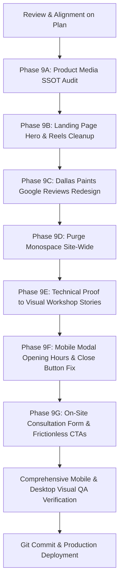

# Comprehensive Brainstorming & Implementation Plan: Captain Feedback & Atelier Realignment

**Date:** November 22, 2026  
**Project:** Niraj Jewellers Ltd — Digital Luxury Flagship  
**Domain:** `https://www.niraj-jewellers.co.uk`  
**Status:** Brainstorming & Architectural Audit Complete (Zero Code Alterations Applied)

---

## 1. Executive Summary & Core Diagnosis

Following review by the second Captain and direct mobile inspection by the client, the site currently exhibits a fundamental tension:
* **The Good:** Strong serif luxury typography, structured 3-column collection grid, and well-organized same-day repair tiers.
* **The Problem:** The design language leans too heavily into a **"developer dashboard / technical terminal"** aesthetic rather than an elite, warm, trustworthy Mayfair/West London luxury jewellery atelier.
* **The Client Bug Findings:**
  1. **Image 2 (Modal Mobile Overflow):** Awkward text wrapping and truncation on opening hours in the Showroom Dossier Modal (`Tue to [break] t 11:00 to 17:30`), plus redundant bottom close button.
  2. **Images 3 & 4 (Severe Product & Media Mismatch):** Product cards titled *"The Koh-i-Noor Inspired Solitaire Engagement Ring"* display a pearl/Kundan choker necklace image and play a tennis necklace video. Database merging logic in `lib/db/index.ts` was arbitrarily assigning mismatched media from unused vault items.

---

## 2. Deep-Dive Brainstorming by Workstream

### Workstream A: Remove "Developer Dashboard" Clutter & Metadata Overload
* **Current Issue:**
  - Section indices like `[ 01 / GOLDSMITH KNOWLEDGE & EDUCATION ]`, `01 — 06`, `[ 02 / FREQUENTLY ASKED QUESTIONS ]` evoke a CMS admin console or technical specification doc.
  - Eyebrows like `PROOF ARCHITECTURE & PROVENANCE`, `HAYES BENCH REEL 01 / 03`, `DIRECT MASTERWORK RECORDING` distract from the jewelry.
  - Stacked pill badges under the hero CTAs (`42-YEAR GOLDSMITH LINEAGE`, `LONDON ASSAY LEOPARD'S HEAD`, `100% IN-HOUSE BENCHWORK`, `DIRECT BULLION TRADE VALUE`) clutter the hero whitespace.
* **Brainstormed Solution:**
  - **Eliminate all bracketed index counters** (`[ 01 ]`, `[ 02 ]`, `[ 03 ]`) across every page.
  - Replace technical metadata labels with warm, elegant luxury editorial eyebrows:
    - Change `[ 01 / GOLDSMITH KNOWLEDGE & EDUCATION ]` -> `ATELIER JOURNAL` or `GOLDSMITH KNOWLEDGE`
    - Change `PROOF ARCHITECTURE & PROVENANCE` -> `TRADITION & INTEGRITY`
  - Remove the 4 stacked pill badges below the hero CTAs entirely, letting the hero breathe with generous luxury whitespace.

---

### Workstream B: Purge the Monospace ("Coding") Font Site-Wide
* **Current Issue:**
  - Monospace font (`font-mono`) is used in CTA buttons (`EXPLORE 3 CURATED MASTERPIECES`, `WHATSAPP CONCIERGE`), repair pricing badges (`From £35 / ring`), product weights, and specs. Monospace is a software development typeface; it creates an artificial, cold vibe that clashes directly with handcrafted 22ct gold and diamond jewellery.
* **Brainstormed Solution:**
  - Replace `font-mono` globally with a refined, high-end sans-serif:
    - Primary Body & Subtext: Clean sans-serif with tracking: `tracking-wider` or `tracking-widest` in clean uppercase for small labels.
    - Currency & Pricing: Elegant serif or clean modern tabular sans-serif (e.g. `From £35` with subtle `per ring` subtext), eliminating the "terminal" feel.
    - Buttons & Action Links: Clean sans-serif, uppercase with subtle letter spacing, perfectly balanced with the serif headings.

---

### Workstream C: Eliminate Blurry Top Video Showcase (`Featured Atelier Reels`)
* **Current Issue:**
  - The top horizontal video hero player in `CinematicHero` stretches and crops 9:16 vertical smartphone reels into an awkward horizontal container, making videos look blurry and low-resolution.
  - The section immediately below it (`Curated Masterpieces & Bridal Suites` 3-column grid) features the **exact same 3 pieces** (*Chevron V-Collar*, *Crown Milgrain Band*, *Sovereign Eternity Band*) where the imagery and videos look crisp, native, and properly proportioned.
* **Brainstormed Solution:**
  - **Remove `Featured Atelier Reels` completely** from the landing page.
  - Elevate the **3-Column Curated Masterpieces & Bridal Suites** grid to take center stage directly below the hero statement.
  - Add a clean, understated luxury button below the 3 pieces: `Explore the Complete 54-Piece Vault →` linking seamlessly to `/collections`.

---

### Workstream D: Replace Technical "Proof" Dashboards with Authentic Workshop Photography
* **Current Issue:**
  - "The Heirloom Delivery Standard" and "Forged Solid on Hayes Benches" feature dense technical cards with metrics like `22ct Gold Density 19.32 g/cm³` and `Trade Class II Scales`. Visitors looking for engagement rings or bridal sets skip right past dense technical text.
* **Brainstormed Solution:**
  - Transform these sections from text-heavy metric cards into an **editorial photo-story grid**:
    1. **The Hayes Storefront & Private Consultation Lounge** (real facade / welcoming showroom photo).
    2. **Behind-the-Bench Goldsmithing** (close-up of master goldsmith setting stones or checking a ring under the loupe).
    3. **Raw 24ct Bullion to Cast 22ct Heirloom** (authentic lost-wax casting crucibles and finished polished suites).
  - Short, evocative 2-line captions instead of paragraph walls.

---

### Workstream E: Redesign Google Reviews to Dallas Paints Moving Carousel Benchmark
* **Current Issue:**
  - Current reviews have custom tags (`Google Verified Client`, `BESPOKE JEWELLERY & NOSE STUD FITTING`, `HELPFUL`) that feel artificial, hand-coded, and dashboard-like.
* **Brainstormed Solution (Faithful to the Dallas Paints Reference in Image 1):**
  - **Header Structure:**
    - Eyebrow: `WHAT CLIENTS SAY` (clean, centered)
    - Heading: `Don't Take Our Word For It` (refined Cormorant / serif)
    - Subtitle: `We could tell you about our attention to detail, but we would rather let our customers speak for themselves.`
  - **Google Summary Bar:**
    - Official Google `G` multi-color icon + `4.9` rating + 5 gold stars + `120+ reviews` + `Read all reviews →` link.
  - **Dual-Row Infinite Moving Carousel (Dallas Paints Layout):**
    - 2 staggered rows of authentic Google review cards continuously gliding horizontally at 60fps GPU acceleration.
    - Row 1 glides left; Row 2 glides right.
    - Soft gradient edge masks (`from-[#FAF9F5] to-transparent`) for seamless entrance and exit.
    - Seamless pause-on-hover and pause-on-touch so patrons can easily read any review.
  - **Card Structure:**
    - Clean white cards (`w-[290px] sm:w-[360px]`, `rounded-2xl`, subtle border and shadow).
    - Top Row: Reviewer initial in an avatar circle (e.g., `L` for Lisa), reviewer name (`Lisa K.`), relative date (`11 months ago`), and official Google `G` icon top-right.
    - Middle: 5 solid gold stars (`#FBBC05`).
    - Bottom: The authentic review quote in clean, comfortable sans-serif body text.
    - **Zero custom badges** (`Google Verified Client`, `HELPFUL`, etc.).

---

### Workstream F: On-Site Frictionless Consultation Form (Reduce WhatsApp Exit Barrier)
* **Current Issue:**
  - Forcing every visitor to immediately leave the site and open WhatsApp introduces friction for users on desktop, users without WhatsApp installed, or clients wanting a private email quote.
* **Brainstormed Solution:**
  - Implement a streamlined, elegant **Atelier Consultation Request Form** directly on the landing page:
    - Fields: Full Name, Phone / Email, Service Selection (Bespoke Bridal, Ring Resizing, Diamond Sourcing, Gold Bullion), and Optional Note / File Upload note.
    - Action: Dual submission—submits directly to atelier team inbox/database AND gives the option: *"Prefer instant chat? Launch WhatsApp with your details"*.
  - Keeps the visitor engaged on-site while preserving instant WhatsApp access for those who prefer mobile chat.

---

### Workstream G: Fix Mobile Modal Layout & Opening Hours Text Truncation (Image 2)
* **Root Cause Found in `components/atelier/ShowroomDossierModal.tsx`:**
  - Line 234: The hours `Mon 12:00 to 17:00 | Tue to Sat 11:00 to 17:30` are placed in a right-aligned flex column with `shrink-0` beside the showroom address. On 375px/390px viewports, the horizontal space is restricted, forcing the text to wrap awkwardly across lines (`Tue to` on line 1, `t 11:00 to 17:30` on line 2).
  - Also, there is a redundant bottom button (`CLOSE DOSSIER & RETURN TO SHOWROOM`) when the top-right `CLOSE X` is already present.
* **Brainstormed Solution:**
  - Restructure the showroom information block inside the modal:
    - Stack the address and hours vertically on mobile, or display them in clean, dedicated tabular rows:
      ```
      Opening Hours:
      Monday: 12:00 to 17:00
      Tuesday - Saturday: 11:00 to 17:30
      ```
    - Remove the redundant bottom close button, keeping the single clean top-right close button.
    - Replace all `font-mono` in the modal with refined sans-serif.

---

### Workstream H: Fix Product & Modal Media Mismatch Bug (Images 3 & 4)
* **Root Cause Found in `lib/db/index.ts` & `data/collections-data.ts`:**
  - In `lib/db/index.ts` (lines 117–141), `getCollections()` executes fallback merging logic:
    ```ts
    if (!thumbnailUrl || seenThumbs.has(thumbnailUrl)) {
      const unused = COLLECTIONS_DATA.find((c) => !seenThumbs.has(c.thumbnailUrl));
      thumbnailUrl = unused ? unused.thumbnailUrl : (candidate || item.thumbnail_url || "");
    }
    ```
    When Supabase returns collections records with missing or duplicate URLs, it grabs the first "unused" thumbnail from `COLLECTIONS_DATA`—assigning a **Kundan choker necklace photo** to *"The Koh-i-Noor Inspired Solitaire Engagement Ring"*!
  - Furthermore, `video_url` matching logic falls back across the array, causing a ring modal to load a tennis necklace video reel!
* **Brainstormed Solution:**
  - **Single Source of Truth (SSOT):** Ensure `data/collections-data.ts` is the strict canonical source of truth for all 54 pieces.
  - Audit every single piece in `COLLECTIONS_DATA` to ensure:
    - If title is an **Engagement Ring** -> Thumbnail must be an image of an engagement ring; video must be of an engagement ring.
    - If title is a **Choker Necklace** -> Thumbnail must be the choker necklace; video must be the choker necklace.
    - If title is a **Kada / Bangle** -> Thumbnail must be a kada; video must be a kada.
  - Refactor `lib/db/index.ts`: Eliminate the arbitrary "unused thumbnail fallback" swapping logic. If Supabase data does not match the canonical ID, fallback directly to the exact canonical piece without thumbnail theft or cross-contamination.

---

## 3. Step-by-Step Implementation Roadmap



---

## 4. Verification Checkpoints

1. **Modal Inspection (Mobile 390px):**
   - Verify opening hours format cleanly without awkward line breaking (`Mon 12:00 to 17:00`, `Tue to Sat 11:00 to 17:30`).
   - Confirm exactly one top-right close button.
2. **Product & Modal Truthfulness:**
   - Click "The Koh-i-Noor Inspired Solitaire Engagement Ring": verify thumbnail is an engagement ring, modal title is the engagement ring, and video/still frame shows the engagement ring.
   - Verify all other 53 pieces in the vault have matching imagery, video, title, and category.
3. **Typography Audit:**
   - Grep `font-mono` across `components/` and `app/`: replace with clean luxury sans-serif (`font-sans tracking-wider`).
4. **Dallas Paints Reviews Audit:**
   - Match exact layout from reference: avatar initial circle, reviewer name, relative date, Google logo, 5 stars, review text.
5. **Zero Horizontal Overflow:**
   - `scrollWidth <= 390` across all screens.
